<picture>
  <source media="(prefers-color-scheme: dark)" srcset="./cards/hero-dark.svg">
  
</picture>

**Hi, I'm Maryam.** I'm a Business Analytics and Information Systems student at UBT in Jeddah. I build software that has to work with real money and real people: **Flaire**, a control layer for AI agents that spend, and **Career Studio**, an AI coach that gets students from a blank page to a finished résumé. I also run the UBT Sustainability Club.

  
  
  
  
  
  

<a href="https://github.com/itsmaryaamm/flaire"><picture><source media="(prefers-color-scheme: dark)" srcset="./cards/flaire-dark.svg"></picture></a>
<a href="https://github.com/itsmaryaamm/StudentCareerStudio"><picture><source media="(prefers-color-scheme: dark)" srcset="./cards/career-dark.svg"></picture></a>
<a href="https://github.com/itsmaryaamm/ubt-sustainability-club"><picture><source media="(prefers-color-scheme: dark)" srcset="./cards/green-dark.svg"></picture></a>

<picture>
  <source media="(prefers-color-scheme: dark)" srcset="./cards/stack-dark.svg">
  
</picture>

### Why Flaire

AI agents are starting to spend money, and nobody wants to hand them an open wallet. Flaire gives every agent its own card, a budget, and one switch above all of them. React and FastAPI on the front and back, PostgreSQL underneath, Claude agents doing the work. There is also a [PayPal sandbox version](https://github.com/itsmaryaamm/flaire-paypal) built for a hackathon.

  
GitHub activity

   
  

    
    
  

  

    <picture>
      <source media="(prefers-color-scheme: dark)" srcset="https://raw.githubusercontent.com/itsmaryaamm/itsmaryaamm/output/github-snake-dark.svg">
      
    </picture>
  

